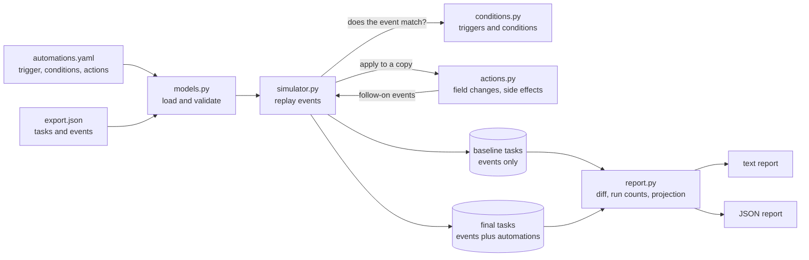

# clickup-dry-run

Task automations are easy to switch on and hard to predict: one rule quietly fires another, and every firing eats into a monthly run allowance.
This tool replays automations against an exported task file so you can see exactly which tasks would change, and how many runs it would cost, before anything touches the real workspace.

It is an independent simulator written in the style of ClickUp automations. It is not affiliated with ClickUp and never calls its API.

## What it does

- Reads automations from YAML, each one a `trigger`, a list of `conditions` and a list of `actions`.
- Reads a task export (JSON) holding a task snapshot and a log of events to replay. A fake export is included.
- Replays each event, fires every automation whose trigger and conditions match, and applies the actions to an in-memory copy.
- Follows chains: an action that changes status, priority, tags, assignees, list or a custom field can fire other automations. Loops are detected and stopped with a warning.
- Reports, per task, the net field changes caused by automations (before and after, and which automation did it), the comments and subtasks that would be created, and a full run log.
- Counts runs, including runs that change nothing and runs fired by other automations, projects them over 30 days, and compares that with a monthly limit.
- Output as text or JSON. `--strict` returns a failing exit code on warnings or when the projection is over the limit, so it can gate a change in CI.

## Architecture



The simulator keeps two copies of the tasks. The baseline gets only the replayed events. The final copy also gets every automation action. The difference between the two is what the automations would change, so a status change that a person made is never blamed on a rule.

## Run it

```bash
python -m venv .venv && . .venv/bin/activate    # Windows: .venv\Scripts\activate
pip install -r requirements-dev.txt
python -m dryrun examples/automations.yaml examples/export.json --as-of 2026-03-06 --monthly-limit 100
```

Options:

| Flag | Meaning |
| --- | --- |
| `--as-of YYYY-MM-DD` | Also fire `due_date_arrives` for every task due on that date |
| `--monthly-limit N` | Run allowance to compare the 30 day projection against (or set `DRYRUN_MONTHLY_LIMIT`, see `.env.example`) |
| `--events FILE` | Replay a different event list against the same snapshot, for "what if" checks |
| `--max-depth N` | How many automations may chain off one event (default 5) |
| `--json` | Machine readable report |
| `--strict` | Exit 1 on any warning or when the projection is over the limit |

## Writing automations

```yaml
automations:
  - id: complete-to-invoicing
    name: Finished paid work moves to the invoicing list
    trigger:
      type: status_changed
      to: complete            # a single value or a list
    match: all                # all (default) or any
    conditions:
      - field: custom.Estimate
        op: gt
        value: 0
    actions:
      - type: move_to_list
        to: Invoicing
      - type: remove_tag
        tag: triage
```

| Part | Supported |
| --- | --- |
| Triggers | `task_created`, `status_changed` (from, to), `priority_changed` (to), `tag_added` (tag), `assignee_added` (assignee), `custom_field_changed` (field, to), `moved_to_list` (to), `due_date_arrives` |
| Condition fields | `name`, `status`, `priority`, `assignees`, `tags`, `list`, `due_date`, `custom.<field name>` |
| Condition ops | `equals`, `not_equals`, `in`, `not_in`, `contains`, `not_contains`, `is_set`, `is_not_set`, `gt`, `gte`, `lt`, `lte`, `before`, `after` |
| Actions | `change_status`, `change_priority`, `add_tag`, `remove_tag`, `add_assignee`, `remove_assignee`, `set_custom_field`, `set_due_date` (date or days_from_trigger), `move_to_list`, `add_comment`, `create_subtask` |

Text comparisons ignore case. The condition value `today` resolves to the date of the triggering event. Comment and subtask text can use `{{task.name}}` style placeholders. Set `enabled: false` to keep a rule in the file without firing it. Malformed files are rejected with a message naming the automation and the problem.

## Tests

```bash
python -m pytest -q
```

51 tests cover condition and trigger matching, config validation, chaining, loop and depth guards, the baseline diff, the run projection and the CLI. CI (`.github/workflows/ci.yml`) runs them on Python 3.10 and 3.12 and checks that the demo still reproduces `demo/output.txt`.

## Demo

```bash
python demo/run_demo.py          # add --save to rewrite demo/output.txt
```

Runs fully offline against the fake export. The captured output is in [demo/output.txt](demo/output.txt). Things worth noticing in it:

- 12 runs from 13 events, of which 3 were fired by other automations rather than by a person.
- `escalated-is-urgent` fires on a task that is already urgent: a run that is paid for and changes nothing.
- The free site visit (estimate 0) is correctly left out of invoicing by a condition.
- One event points at a task that is not in the export and is reported as a warning instead of being silently dropped.

## Where this pattern runs

The dry run first approach here is drawn from systems that run two small service companies day to day, where task automations route intake, hand work between people and move finished jobs toward invoicing. In that setting a wrong rule reassigns real work, so rule changes are replayed against an export and read before they are switched on. All data in this repository is synthetic.

## Limitations

- It models a subset of automation behaviour, by the rules documented above. A live workspace has more triggers, actions and edge cases, and its exact ordering and loop handling may differ. Treat the result as a strong prediction, not a guarantee.
- The export format is this project's own simplified JSON (named statuses, ISO dates, an `events` list). A real workspace export or API response needs a small adapter to be reshaped into it; none is included.
- Run counting assumes one run each time a trigger fires and the conditions pass, including runs that change nothing. Check that against how your plan counts usage.
- The 30 day projection is a straight line from the event window in the file. A short or unusual window gives a poor projection.
- `due_date_arrives` fires only for tasks due exactly on the `--as-of` date. There are no time of day, recurring or relative schedule triggers.
- Comments and subtasks are reported as side effects only. A simulated subtask does not become a task that other automations can fire on.
- Conditions are evaluated against the task as it stands when the automation fires, so an earlier automation on the same event can affect a later one. Automations fire in file order.

License: MIT, see the LICENSE file.
