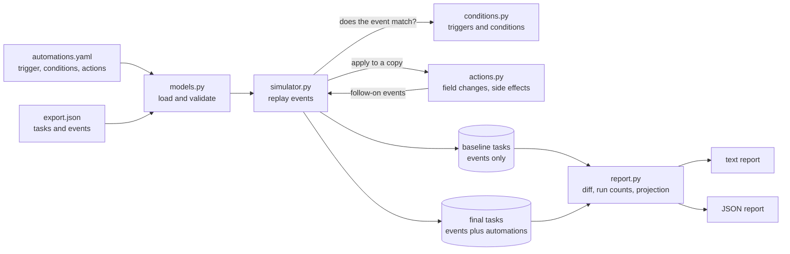

# clickup-dry-run

**See what a set of task automations would do, and how many automation runs they would use, before you switch them on.**

For ClickUp admins on a plan with a limited monthly automation allowance. Automations are easy to turn on and hard to predict: one rule quietly fires another, some runs change nothing, and every run counts against the allowance.

You describe the automations in a short YAML file and give the tool a JSON file of tasks and recent activity. It replays the activity on a copy of the tasks and prints:

- which tasks would change, field by field, and which automation did it
- every comment and subtask that would be created
- how many runs that took, how many were wasted or fired by another automation, and a 30 day projection against your limit
- warnings for loops and for activity that points at a missing task

Nothing is sent anywhere. It is an offline Python command line tool with one dependency (PyYAML).

Read this before relying on it: it is an independent simulator written in the style of ClickUp automations. It is not affiliated with ClickUp, never calls the ClickUp API, cannot read a ClickUp export directly, and has only been run on the synthetic sample data in this repository. See [Limitations](#limitations).

## What you will see

An excerpt of the report for the sample data (`...` marks lines cut for length). The full output is in [demo/output.txt](demo/output.txt), and CI fails if the demo stops reproducing that file.

```text
$ python -m dryrun examples/automations.yaml examples/export.json --as-of 2026-03-06 --monthly-limit 100

DRY RUN: nothing was sent anywhere. All changes below are simulated.
====================================================================
Tasks in export: 12   Events replayed: 13   Automations: 8 (1 disabled)

Runs by automation
  intake-triage          2 runs
  urgent-escalation      3 runs (1 fired by another automation)
  escalated-is-urgent    2 runs (1 changed nothing, 1 fired by another automation)
  ...
Tasks that would change: 8 of 12
  ...
  T-1006  Sample job: hang three interior doors
    tags                   [triage] -> (none)   [complete-to-invoicing]
    list                   Scheduled Jobs -> Invoicing   [complete-to-invoicing]
    custom.Invoice Status  (none) -> draft   [invoicing-arrival]
  ...
Warnings: 1
  ! event e10 refers to task T-1099, not in the export; skipped

Automation usage
  Runs this replay:                12
  Runs that change nothing:        1
  Runs fired by other automations: 3
  Event window:                    5 day(s)
  Projected over 30 days:          72
  Monthly limit:                   100 (72.0% used at this rate, within limit)
```

## What it does

- Reads automations from YAML, each one a `trigger`, a list of `conditions` and a list of `actions`.
- Reads a task file (JSON, in this project's own format) holding a task snapshot and a log of events to replay. A fake one is included.
- Replays each event, fires every automation whose trigger and conditions match, and applies the actions to an in-memory copy.
- Follows chains: an action that changes status, priority, tags, assignees, list or a custom field can fire other automations. Loops are detected and stopped with a warning.
- Reports, per task, the net field changes caused by automations (before and after, and which automation did it), the comments and subtasks that would be created, and a full run log.
- Counts runs, including runs that change nothing and runs fired by other automations, projects them over 30 days in a straight line, and compares that with a monthly limit.
- Output as text or JSON. `--strict` returns a failing exit code on warnings or when the projection is over the limit, so it can gate a change in CI.

## Architecture



The simulator keeps two copies of the tasks. The baseline gets only the replayed events. The final copy also gets every automation action. The difference between the two is what the automations would change, so a status change that a person made is never blamed on a rule.

## Run it

```bash
python -m venv .venv && . .venv/bin/activate    # Windows: .venv\Scripts\activate
pip install -r requirements-dev.txt
python -m dryrun examples/automations.yaml examples/export.json --as-of 2026-03-06 --monthly-limit 100
```

Options:

| Flag | Meaning |
| --- | --- |
| `--as-of YYYY-MM-DD` | After the replay, also fire `due_date_arrives` for every task due on that date |
| `--monthly-limit N` | Run allowance to compare the 30 day projection against (or set `DRYRUN_MONTHLY_LIMIT`, see `.env.example`) |
| `--events FILE` | Replay a different event list against the same snapshot, for "what if" checks |
| `--max-depth N` | How many automations may chain off one event (default 5) |
| `--json` | Machine readable report |
| `--strict` | Exit 1 on any warning or when the projection is over the limit |

## Writing automations

```yaml
automations:
  - id: complete-to-invoicing
    name: Finished paid work moves to the invoicing list
    trigger:
      type: status_changed
      to: complete            # a single value or a list
    match: all                # all (default) or any
    conditions:
      - field: custom.Estimate
        op: gt
        value: 0
    actions:
      - type: move_to_list
        to: Invoicing
      - type: remove_tag
        tag: triage
```

| Part | Supported |
| --- | --- |
| Triggers | `task_created`, `status_changed` (from, to), `priority_changed` (to), `tag_added` (tag), `assignee_added` (assignee), `custom_field_changed` (field, to), `moved_to_list` (to), `due_date_arrives` |
| Condition fields | `name`, `status`, `priority`, `assignees`, `tags`, `list`, `due_date`, `custom.<field name>` |
| Condition ops | `equals`, `not_equals`, `in`, `not_in`, `contains`, `not_contains`, `is_set`, `is_not_set`, `gt`, `gte`, `lt`, `lte`, `before`, `after` |
| Actions | `change_status`, `change_priority`, `add_tag`, `remove_tag`, `add_assignee`, `remove_assignee`, `set_custom_field`, `set_due_date` (date or days_from_trigger), `move_to_list`, `add_comment`, `create_subtask` |

Text comparisons ignore case. A `status_changed` event that leaves out `from` takes the old status from the task. The condition value `today` resolves to the date of the triggering event. Comment and subtask text can use `{{task.name}}` style placeholders. Set `enabled: false` to keep a rule in the file without firing it. Malformed files are rejected with a message naming the automation and the problem.

## Tests

```bash
python -m pytest -q
```

55 tests cover condition and trigger matching, config validation, chaining, loop and depth guards, the baseline diff, the run projection and the CLI. CI (`.github/workflows/ci.yml`) runs them on Python 3.10 and 3.12 and checks that the demo still reproduces `demo/output.txt`.

## Demo

```bash
python demo/run_demo.py          # add --save to rewrite demo/output.txt
```

Runs fully offline against the fake export. The captured output is in [demo/output.txt](demo/output.txt). Things worth noticing in it:

- 12 runs from 13 events (9 from the file plus 4 due date events from `--as-of`; a tenth file event is skipped with a warning). 3 of the runs were fired by other automations rather than by a person.
- `escalated-is-urgent` fires on a task that is already urgent: a run that is paid for and changes nothing.
- The free site visit (estimate 0) is correctly left out of invoicing by a condition.
- One event points at a task that is not in the export and is reported as a warning instead of being silently dropped.

## Background

The dry run first idea comes from working with task automations that route intake, hand work between people and move finished jobs toward invoicing in small service businesses, where a wrong rule reassigns real work. This repository is a standalone demonstration of that idea. All data in it is synthetic, and the code has not been run against a live workspace.

## Limitations

- Never checked against a live ClickUp workspace. There is no API client and nothing is mocked: the tool only reads two local files. The trigger, condition and action rules are this project's own model, documented above, and nobody has compared its output with what ClickUp does on the same tasks. Treat the result as a prediction under those rules, not a guarantee.
- It cannot read a ClickUp export or API response. The input is this project's own simplified JSON (named statuses, ISO dates, an `events` list), and the automations have to be retyped by hand as YAML. An adapter is needed for real data; none is included.
- It models a subset of automation behaviour. A live workspace has more triggers, actions and edge cases, and its ordering and loop handling may differ. Here automations fire in file order, an automation fires at most once per task in a chain, and chains stop at `--max-depth`.
- Run counting assumes one run each time a trigger fires and the conditions pass, including runs that change nothing. That is an assumption, not a published billing rule. Check it against how your plan counts usage.
- The 30 day projection is a straight line from the event window in the file. A short or unusual window gives a poor projection. Due date runs are counted for the single `--as-of` day only, so they are under-represented in it.
- `due_date_arrives` fires only for tasks due exactly on the `--as-of` date, using due dates as they stand after the replay. There are no time of day, recurring or relative schedule triggers.
- Comments and subtasks are reported as side effects only. A simulated subtask does not become a task that other automations can fire on.
- Conditions are evaluated against the task as it stands when the automation fires, so an earlier automation on the same event can affect a later one.
- `equals` does not treat the number 180 and the text "180" as the same value (`gt`, `lt` and the other ordering ops do).
- The only data it has run on is the 12 task sample file here. Speed and behaviour on a large export are untested.

License: MIT, see the LICENSE file.
